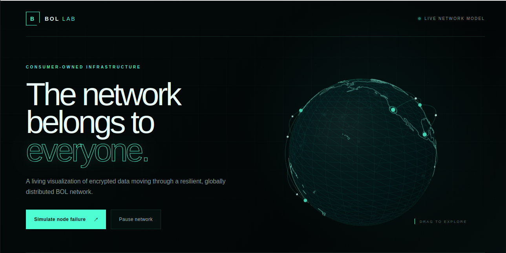

<h1 align="center">BOL — The infrastructure is the network.</h1>

<p align="center">
Verifiable storage across independent machines—designed for AI teams and regulated businesses that need trustworthy data integrity, storage evidence, and auditable durability.
</p>

<p align="center">
  <a href="#whats-in-this-repository">What's here</a> ·
  <a href="docs/dev_journal/2026-11-12_engineering_operating_procedure.md">Latest engineering journal</a> ·
  <a href="#roadmap">Roadmap</a> ·
  <a href="#get-involved">Get involved</a> ·
  <a href="LICENSE">MIT License</a>
</p>

**STORE → DISTRIBUTE → VERIFY → PROVE → RECOVER**

BOL is an early-stage, MIT-licensed prototype. It is **not production-ready**.

> **Read this first:** this repository contains BOL's public control-plane prototype. The later Phase 12–14 work described in the [development journals](docs/dev_journal/) — the authenticated Node Agent, possession challenges and durability assessment — is **not included in this checkout**. Those journals describe work done outside this repository; you cannot reproduce it from this code.

## Why BOL?

Independent machines can contribute storage. Coordinating them takes more than recording where copies are supposed to exist.

BOL's core idea is to keep two questions apart:

- **Desired durability:** how many copies does policy require?
- **Provable durability:** which copies does the evidence actually support?

A replica record alone does not prove a node still has the bytes. Storage is the current focus; content delivery, distributed compute and AI infrastructure are longer-term goals.

## Who it's for

BOL's intended first market is teams that need to prove their stored data, not just store it:

- **AI teams** storing training datasets and model checkpoints that must stay intact and auditable.
- **Regulated businesses** that answer to auditors about the integrity and durability of their data.

This is a target market, not a commercially available or compliance-certified product.

BOL's possession challenges (documented in the journals; not in this checkout) verify **stored bytes**: that a node returned the expected content when challenged. It does not establish where training data originated, whether a model was trained on it, or the physical location or continuous custody of a copy. Dataset provenance requires additional systems.

## What's in this repository

A single FastAPI control node backed by PostgreSQL. It runs everything on one machine and simulates nodes as database records and local folders.

| Area | What the code does |
| --- | --- |
| Nodes | Register nodes, heartbeats, online/offline status, capacity reports, simulated node failure and failover. |
| Files and chunks | Upload files, split them into chunks, place chunks on nodes, rebuild files from chunks. |
| Replicas | Create and materialize chunk replicas across nodes. |
| Integrity | SHA-256 checksums per chunk, verify files/chunks, simulate corruption, rebuild corrupt chunks from replicas. |
| Encryption | Fernet encryption of uploaded files before chunking, and decryption on download. |
| Validators | Read-only database checks for orphans, duplicates, primaries and healthy copies (`validators/`, `scripts/`). |
| Auth | One shared API key (`X-API-Key` header) on every endpoint. |

Not in this repository: a separate node agent, real network transfer between machines, possession challenges, freshness policy, schedulers or automatic repair.

## Quick start

Requires Python 3.10+ and PostgreSQL.

```bash
pip install -r requirements.txt
cp .env.example .env        # then set DB_* and BOL_API_KEY
uvicorn app:app --reload
curl -H "X-API-Key: <your key>" http://127.0.0.1:8000/
```

Tables are created on startup if they don't exist.

Run the smoke tests (no database needed; the connection is mocked):

```bash
pip install -r requirements-dev.txt
pytest
```

## Known limitations

- Single control node; "nodes" are simulated on one machine.
- Encryption keys are stored in the same database as the file records. Don't use this for real secrets.
- One shared API key; no per-node identity in this code.
- Test coverage is a small smoke suite only.
- No automated scheduling, renewal or repair.

## Development journals

The [journals](docs/dev_journal/) record the project's design work phase by phase, including later work (Phases 12–14D) whose code is not public. Treat them as design notes and progress reports, not as documentation for this checkout.

## Explore the network vision

**Concept simulation—not a live or certified network.** Statistics are simulated, and depicted failover behavior illustrates the intended architecture rather than delivered Phase 14 automatic repair.

[](https://bol-network-visualizer.asirpal11.chatgpt.site)

[Open the interactive concept visualization](https://bol-network-visualizer.asirpal11.chatgpt.site)

**Next public visual asset:** a sanitized possession-challenge demonstration showing BOL's byte measurement, historical proof and the unconfigured freshness limit. This is the highest-priority planned visual; it has not been created yet.

## Roadmap

| Stage | Status |
| --- | --- |
| Public prototype (this repo) | Single-node control plane: chunking, replicas, checksums, encryption, simulated failover |
| Phases 11–14D | Documented in journals; code not public |
| Next | Automated renewal, repair and re-replication |

### The broader direction

**Storage → Verified possession → AI datasets & model checkpoints → Automated recovery → Broader distributed infrastructure**

Storage is today's foundation. The interoperability direction spans **AWS, Azure, GCP, on-premises and BOL-native infrastructure**. S3 compatibility is one planned interface, not BOL's platform identity or a delivered integration claim. Content delivery, edge infrastructure, distributed compute, AI inference and broader AI infrastructure remain longer-term goals.

BOL explores voluntary participation by independent operators using existing hardware. Future concepts include a dedicated BOL Node OS, purpose-built devices and compensation for verified contributions. These are vision items, not current product or earnings promises.

Distribution, resilience, security, simplicity and participation guide that work.

## Follow the engineering

- [Phase 14D — Certification Infrastructure](docs/dev_journal/2026-10-22_phase14d_certification_infrastructure.md)
- [Phase 14C — Bounded Remote Possession Measurement](docs/dev_journal/2026-09-28_phase14c_remote_measurement_campaign.md)
- [Phase 14C — First Real Remote Possession Challenge](docs/dev_journal/2026-09-23_phase14c_real_remote_possession.md)
- [Phase 14 — Durability & Possession Assurance](docs/dev_journal/2026-09-20_phase14_durability_possession_assurance.md)
- [Phase 13 — Verified Replication Trust](docs/dev_journal/2026-09-19_phase13_verified_replication_trust.md)
- [Phase 12 — Replica Verification](docs/dev_journal/2026-09-19_phase12_replica_verification_complete.md)
- [Phase 12 — Node Agent Storage Protocol](docs/dev_journal/2026-09-18_phase12_node_agent_storage_protocol.md)
- [Phase 11 — Replica Trust](docs/dev_journal/2026-09-11_phase11_replica_trust.md)
- [All development journals](docs/dev_journal/)
- [Architecture](docs/architecture.md)

Whitepaper: in development.

## Get involved

**⭐ Star BOL to support the project and help others discover it.**

- Follow the development journals and choose your preferred GitHub notification settings.
- Explore the architecture and raise focused questions through [GitHub Issues](https://github.com/adityasirpal/BOL/issues).
- Suggest documentation improvements or discuss the scope of a proposed contribution before starting substantial work.

## Founder and license

**Aditya Sirpal — Founder & CEO**

Building the Future of Internet.

BOL's public repository is licensed under the [MIT License](LICENSE).

> The Internet connected people.
>
> Cloud computing connected applications.
>
> BOL explores connecting infrastructure itself.
